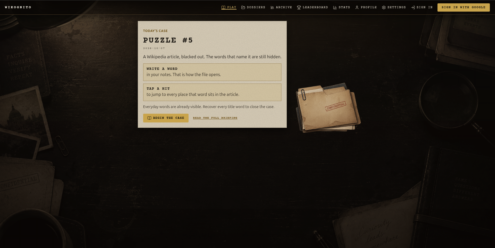
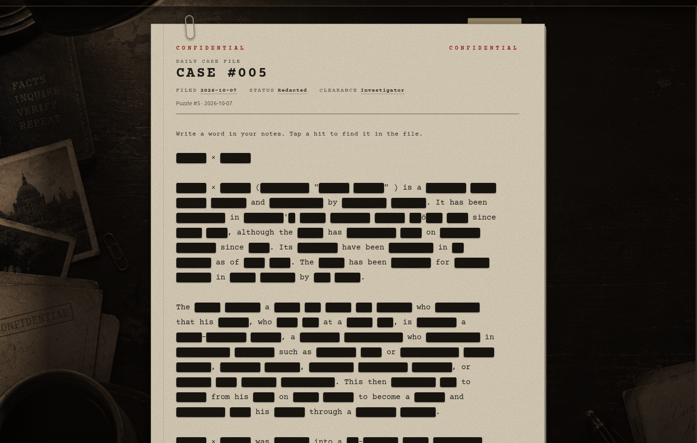
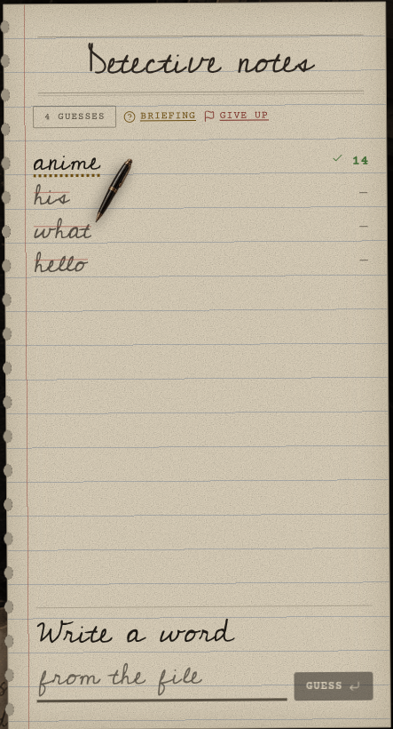
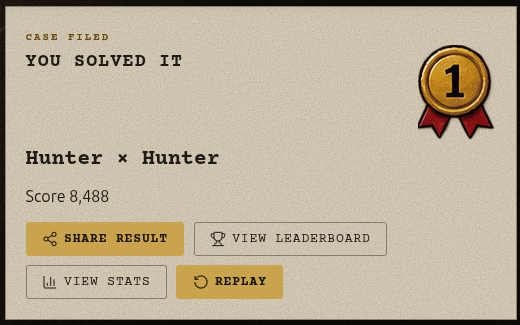
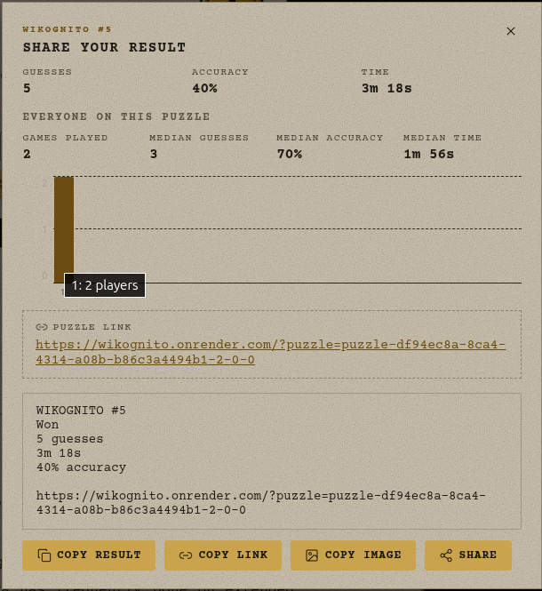
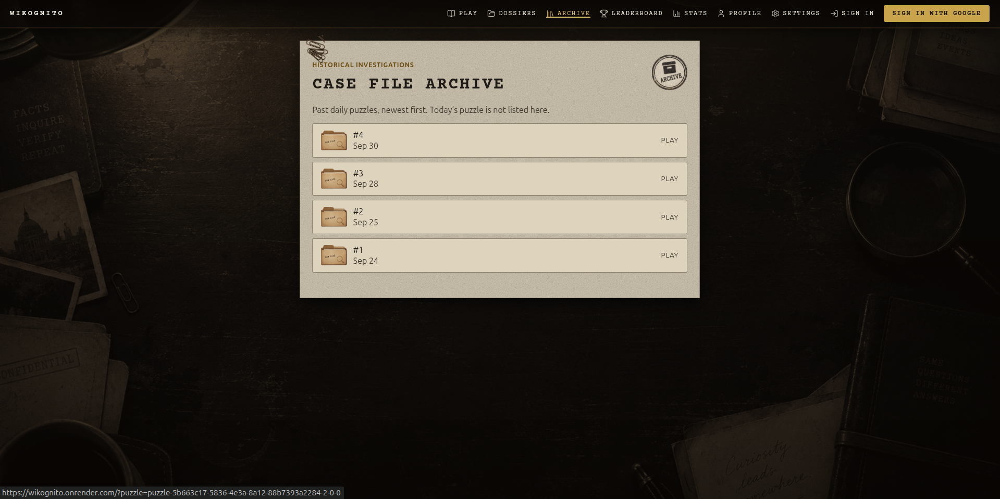

# Wikognito

You are a detective with one case on the desk: a Wikipedia article, mostly blacked out.

Everyday words are already visible. Names, places, dates, and the title are inked over. You guess a word. If it lives in the file, it writes itself back in — every time it appears. Recover the hidden title words and the case is closed.

Play today’s case without an account. Sign in if you want a streak, a history, and a place on the day’s leaderboard.

Want to run it yourself? See [DEVELOPMENT.md](DEVELOPMENT.md).

---

## The theme

Wikognito is a **desk, not a quiz app**. The article is a case file. Your guesses are notes. Hits ink onto the page. When you solve it, the result is filed — stamp, card, share — and the answer stays off the share.

The desk, folders, avatars, and medals are the world. The puzzle is still a Wikipedia article. The fun is the gap between those two things: you are reconstructing a real encyclopedia page from fragments, as if it had been redacted and left on your blotter.

---

## How a case is solved

1. **Open the file.** Common words stay. Everything else is a black bar.
2. **Write a word** in your notes. A hit appears everywhere it sits in the article. Word forms count — *city* also finds *cities*.
3. **Tap a hit** to jump to it in the file. Tap again for the next occurrence.
4. **Tap a black bar** to see how many letters it hides.
5. **Close the case** when every non-common title word is recovered.

Easy leaves more everyday words visible. Hard blacks out more of them. That choice lives in Settings.

---

## What makes it worth sitting with

**Ink, not a score ticker.** Correct guesses write themselves into the article. The page goes from fog to readable as you work.

**The title is the prize.** Gold marks the words that name the case. The rest of the article is the evidence that gets you there.

**Notes that jump.** Right guesses stay in the notepad. Tap one to land on it in the file — useful when a word is hiding three paragraphs down.

**A daily case, plus the archive.** One official puzzle per UTC day. Past files stay on the shelf if you want another investigation.

**Share without spoiling.** The share card is a visual result. It never includes the answer.

**Play first, sign in later.** Guessing runs in the browser. An account claims the current game; it does not unlock the desk.

**Today’s board.** Authenticated official wins land on the leaderboard. Stats, streaks, and an activity calendar live on your profile.

---

## Screens

Save captures under `docs/screenshots/`, then replace each placeholder with:

``

### Today’s case

_Desk intro: “Today’s case”, puzzle number, Begin the case._

<!--  -->

### The redacted file

_Article with black bars, gold title words, notepad and guess line._

<!--  -->

### Hits in the notes

_Guess history with hits; tapping a word jumps in the article._

<!--  -->

### Case closed

_Filed result, stamp, ceremony after a win._

<!--  -->

### Share card

_Visual share result — no answer in the image._

<!--  -->

### Archive

_Past puzzles, available vs solved folders._

<!--  -->

### Leaderboard

_Today’s official-win board._

<!--  -->

### Profile and stats

_Activity calendar, streaks, trends._

<!--  -->

---

## Difficulty

| Setting | What you see |
|---|---|
| Easy | More everyday words already visible |
| Hard | More of those words blacked out |

The article is the same. The fog is not.

---

## For contributors

Clone, install, and run from [DEVELOPMENT.md](DEVELOPMENT.md). Architecture and operations notes live under [`docs/`](docs/).
